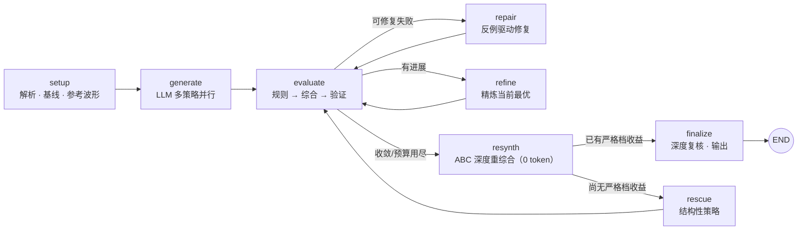
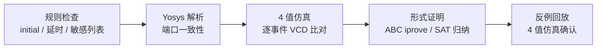

# EDA_work：基于大模型与 Yosys 闭环的 RTL 自动优化 Agent

> 课程大作业：搭建一个 Agent 系统，对输入 RTL 进行**全自动优化**。综合后需满足延时要求（逻辑深度 `ltp` 不恶化），并使面积尽可能小。
> 完整方案报告（PDF）：[`rtl_agent/docs/report/report.pdf`](rtl_agent/docs/report/report.pdf)

本项目实现了 **`rtl_agent`**：输入任意 Verilog 设计，系统在“生成 → 验证 → 评估 → 反馈”的闭环中联合使用两类优化引擎：

- **大模型改写**：多策略并行、反例驱动修复、关键路径引导的精炼；
- **零 token 的 ABC 逻辑重综合**：确定性的深度重综合脚本组合。

评估使用课程评分脚本的面积与逻辑深度指标；层次化设计先展平，并另记未展平的字面基线。每个输出都必须通过与课程检查器同语义的严格 4 值波形比对，以及形式验证（完整证明或有界模型检查，见 [6.1 验收策略](#61-验收策略)）。系统为纯 Python 标准库实现，采用自研的 LangGraph 风格状态图编排（并未引入 LangGraph 依赖）。

---

## 目录

1. [结果概览](#1-结果概览)
2. [评分项与方案对应](#2-评分项与方案对应)
3. [评分口径的复现与实证分析](#3-评分口径的复现与实证分析)
4. [系统架构](#4-系统架构)
5. [优化引擎](#5-优化引擎)
6. [等价性验证体系](#6-等价性验证体系)
7. [效率设计（token 与运行时间）](#7-效率设计token-与运行时间)
8. [开发中发现的关键问题](#8-开发中发现的关键问题)
9. [快速开始](#9-快速开始)
10. [仓库结构](#10-仓库结构)
11. [局限与展望](#11-局限与展望)

---

## 1. 结果概览

本次验收环境：WSL Ubuntu、Yosys 0.52、Icarus Verilog 12；LLM 为 DeepSeek `deepseek-v4.1-flash`（关闭思考），默认验收策略（`--accept bounded`，宽松兜底开启）。同一套系统运行了多轮（`normal` 预算，无收益用例另以 `high` 预算补跑），每个用例取各轮中通过全部验证且 J 最优的结果；`result.json` 中的 `run` 与 `runs_compared` 字段记录来源。表格由 [`rtl_agent/results/`](rtl_agent/results/) 自动生成。

**小结**：8 个官方公开用例中 4 个获得经验证的正收益：定点减法器面积 -23.2%（ltp -13%），accu -6.1%（ltp -16%），radix2 -6.3%，LIFO -3.7%（ltp -6%）。**8 个输出全部通过课程原版检查器**（`equiv_agent.py` + 官方激励），复核表见 [`results/course_check.md`](rtl_agent/results/course_check.md)。其余 4 个用例中，barrel、div16 的原设计自身会产生零宽毛刺事件，任何结构不同的实现都无法在官方激励上逐事件一致；fp_rounding 的基线已很精简；adder64 在面积下降时 ltp 必然加深。额外用例 4 个全部有收益：GCD 面积 -63.3%（ltp 252→53，完整证明），opt_top 面积 -50.5%（LLM 把两个乘法器合并为一个，再经网表化消除自身毛刺）。

> 公开用例为课程仓库 [opti_demo](https://github.com/alex00153/opti_demo) 于 2026-10-21 发布的 8 个官方用例（`case/bench/*`），每个用例都附带官方等价性激励 `stim_*.v`；额外用例覆盖双时钟异步 FIFO、交通灯、GCD 和 demo 电路。隐藏用例未公开，本表不代表隐藏用例成绩。

<!-- RESULTS_TABLE -->

| 用例 | 类型 | 基线面积 | 优化面积 | Δ面积 | 基线 ltp | 优化 ltp | Δltp | token | 耗时(s) | 档位 | 胜出来源 |
|---|---|---:|---:|---:|---:|---:|---:|---:|---:|---|---|
| case1_barrel_shifter | 组合 | 39.4 | 39.4 | **—** | 4 | 4 | — | 25028 | 60 | — | 无正收益，输出原设计 |
| case2_fp_rounding | 组合 | 88.0 | 88.0 | **—** | 11 | 11 | — | 12680 | 44 | — | 无正收益，输出原设计 |
| case3_fixed_point_subtractor | 组合 | 477.7 | 366.8 | **-23.2%** | 30 | 26 | -13.3% | 17115 | 154 | 严格 | 重综合（原设计） |
| case4_div_16bit | 组合 | 775.1 | 775.1 | **—** | 59 | 59 | — | 57148 | 315 | — | 无正收益，输出原设计 |
| case5_verified_accu | 时序 | 74.5 | 70.0 | **-6.1%** | 56 | 47 | -16.1% | 16211 | 47 | 宽松 | 重综合（原设计） |
| case6_LIFObuffer | 时序 | 101.6 | 97.9 | **-3.7%** | 18 | 17 | -5.6% | 24279 | 100 | 严格 | LLM |
| case7_verified_adder_64bit | 时序 | 484.4 | 484.4 | **—** | 57 | 57 | — | 37616 | 152 | — | 无正收益，输出原设计 |
| case8_verified_radix2_div | 时序 | 212.3 | 199.0 | **-6.3%** | 76 | 76 | +0.0% | 23207 | 76 | 宽松 | LLM |
| asyn_fifo | 时序 | 72.6 | 67.6 | **-7.0%** | 39 | 37 | -5.1% | 28551 | 52 | 宽松 | 重综合（原设计） |
| gcd | 组合 | 1715.2 | 629.1 | **-63.3%** | 252 | 53 | -79.0% | 9291 | 650 | 严格 | 重综合（LLM 解） |
| opt_top | 组合 | 764.2 | 378.3 | **-50.5%** | 19 | 17 | -10.5% | 12445 | 484 | 严格 | 重综合（LLM 解） |
| traffic_light | 时序 | 53.5 | 50.8 | **-5.0%** | 45 | 32 | -28.9% | 20353 | 52 | 严格 | 重综合（原设计） |

<!-- /RESULTS_TABLE -->

- **面积**：组合单元面积（µm²，Nangate45）。课程脚本中触发器面积不计入，详见第 3 节。
- **档位**：“严格”表示全部激励下逐事件波形一致，且形式验证通过（完整证明或有界检查）；“宽松”表示形式验证同样通过，复位后各输出完全一致，差异仅限于我们额外施加的“复位前先打拍”激励中的上电 X，或零宽毛刺事件。宽松档只在没有严格档收益时兜底，可用 `--no-relaxed` 关闭。**官方激励不允许宽松**：表中公开用例的宽松档结果在官方激励上都是逐事件严格一致的。
- **形式证据**：每个用例的 `result.json` 中 `verification.formal.status` 记录证据强度：`proved` 为完整证明（组合电路 ABC 证明、时序电路归纳），`bounded` 为 30 拍有界模型检查无反例，`skipped` 为多时钟设计（暂无形式模型，仅严格仿真）。
- **来源**：最终胜出的候选来自哪个引擎。
- **多次运行的差异**：LLM 输出有随机性。例如在官方用例发布前的复刻版 LIFO 上，某一轮 LLM 精炼得到 -36.6%，其他轮次没有复现；官方 LIFO 的收益来自补跑轮的 storage 救援策略。

## 2. 评分项与方案对应

| 评分项 | 分值 | 本方案的对应设计 |
|---|---:|---|
| 流程搭建 | 30 | 完整闭环：RTL 输入 → 基线评估 → 候选生成 → 等价性验证（形式 + 仿真）→ 综合评估 → 反馈修复/精炼 → 最终复核 → 报告 |
| 公开组合/时序电路 | 15+15 | 双引擎优化，按 `0.5·面积 + 0.3·延时` 择优，且保证面积下降、`ltp` 不恶化 |
| Hidden Case | 30 | 不依赖用例知识的通用流程；针对时序电路强化：多时钟激励、复位极性识别、复位前 X 语义检查、存储器处理、救援策略 |
| token / 运行时间 | 各占优化分 10% | 关闭隐式推理，可见的简短分析，并行调用，先评估后验证，零 token 重综合承担主要优化 |
| 方案报告 | 10 | [`report.pdf`](rtl_agent/docs/report/report.pdf) 与本 README |

“正收益”是获得基础分的前提，而基础分在 Hidden Case 中占比超过 40%。因此本方案把**每个用例都拿到经过验证的正收益**放在首位，其次才是追求排名靠前的面积/延时改进。任何未通过等价性验证的候选都不会被输出。

## 3. 评分口径的复现与实证分析

课程 demo 的评分脚本：

```text
read_verilog -sv F; read_liberty -lib LIB; hierarchy -top TOP; proc; opt; techmap; opt;
abc -liberty LIB; stat -liberty LIB; ltp
# area = 最后一条 "Chip area for module"，delay = (length=N)
```

我们在 Yosys 0.52 + Nangate45 上逐项实验，得到以下对优化策略有决定性影响的结论：

| # | 发现 | 证据 | 对策 |
|---|---|---|---|
| 1 | **触发器面积不计入** | 流程中没有 `dfflibmap`，`stat` 报告 `Area for cell type $_DFF_PN0_ is unknown`；被 `opt_dff` 吸收进触发器的使能、同步复位逻辑同样不计 | 时序电路只需优化组合逻辑；鼓励把选择逻辑折叠进触发器使能/同步复位 |
| 2 | **`ltp` 穿过寄存器计数** | 阅读 `passes/cmds/ltp.cc`：对全部连线做最长路径 DFS，触发器是普通节点（未加 `-noff`），遇环截断 | 时序电路的“延时”是穿过移位链、计数器的多周期长链；把关键路径上的具名信号反馈给 LLM |
| 3 | **层次化设计的面积失真** | 脚本不展平且取最后一条模块面积：case1 报的是子模块 `mux2X1` 的 1.862，真实总面积为 39.37 | 一律展平评估（单模块设计两者相同），报告中同时给出字面口径 |
| 4 | **存储器不映射** | 没有 `memory` pass，`$mem` 单元面积“未知”；改写风格若使数组被推断为存储器，LIFO 会“降低”62.8%，但真实硬件并未变小 | 默认**拒绝**此类候选，`--allow-mem` 可开启 |
| 5 | **流程中没有资源共享** | 没有 `share`、`opt -full`、`wreduce`；即使在互斥分支中，每个运算符也会各自生成电路 | 提示词要求显式共享运算符 |
| 6 | **ABC 默认脚本较轻** | 用 `&deepsyn` 预先优化后，课程流程重新综合仍保留大部分收益（组合电路 -5%～-25%） | 零 token 的重综合引擎 |

## 4. 系统架构



`agent/graph.py` 实现了一个 LangGraph 风格的 `StateGraph`：节点读写共享状态，条件边由路由函数决定。没有 API Key 时会直接从 `setup` 进入 `resynth`。

| 模块 | 职责 |
|---|---|
| `graph.py` / `optimizer.py` | 状态图引擎；节点 setup / generate / evaluate / repair / refine / resynth / rescue / finalize；预算、停止条件与救援策略 |
| `llm.py` / `prompts.py` | OpenAI 兼容客户端（重试、思考开关、逐次 token 计量与完整调用留档）；提示词模板与失败反馈生成 |
| `synth.py` | 课程口径评估（展平/字面两种）、单元统计、`ltp` 关键路径解析；设计结构分析（时钟、复位极性、存储器、X 赋值）；Yosys 版本感知 |
| `tbgen.py` / `simcheck.py` / `vcd.py` | 激励生成、iverilog 4 值仿真、与课程检查器同语义的 VCD 比对、反例诊断、分级判定 |
| `formal.py` / `verify.py` | Yosys miter + ABC `iprove`（组合）、SAT 时序归纳（时序）、反例回放、分级验收 |
| `resynth.py` | 零 token 的 ABC 深度重综合组合，以无毛刺的单 always 块输出 |
| `report.py` / `run.py` | 每用例 `report.md` / `result.json`、批量汇总；命令行入口 |

## 5. 优化引擎

### 5.1 大模型多策略改写

- **提示词三部分**：
  1. *评分知识*：哪些单元计面积、触发器免费、`ltp` 的含义、Nangate45 主要单元面积；
  2. *硬约束*：端口/参数不变、逐周期逐位等价、4 值 X 语义（复位前寄存器为 X，`if(X)` 走 else 分支）、仿真按事件比对（禁止显式敏感列表、输出每次求值只赋值一次）；
  3. *优化手册*：本流程不做资源共享，需显式共享运算符；按值域收窄位宽（例如只在 0..8 计数的计数器只需 4 位）；把逻辑折叠进触发器的使能和复位；状态机重编码等。
- **并行多策略**：每轮并行发起若干调用，分别侧重保守简化、数据通路、控制逻辑、时序/寄存器利用、最简实现。
- **用可见的简短分析代替隐式推理**：实测 `deepseek-v4.1-flash` 开启思考后，单次推理达到 16000 token 仍未给出答案，思考预算参数也不生效。改为先写不超过 8 行的 `ANALYSIS`（逐分支说明原设计行为），再写 `PLAN` 与代码。
- **反例驱动修复**：回灌最多 3 个反例（输入、期望值、实际值、周期、激励类型），要求先在 `TRACE` 中手推原设计与自身设计的分支走向再修复；对 X 传播差异、事件差异给出专门提示。
- **精炼**：在当前最优的已验证设计上继续优化，附带单元构成与 `ltp` 关键路径上的具名信号（如 `rstn -> current_state -> count -> dividend_e`）。
- **救援**：若常规轮次和重综合都没有严格档收益，追加少量调用，并换用结构性策略：流水预计算（pipeline）、栈/队列改移位结构（storage）、状态机重编码（fsm）；提示词附上此前失败尝试的摘要。

**典型的 LLM 语义级优化**（ABC 做不到）：

- **LIFO**：救援轮的 storage 策略把 4×4 栈存储改为 4 个独立寄存器，读写改为按 SP 选择，并合并冗余的 `FULL`/`EMPTY` 计算（官方用例面积 -3.7%、ltp -6%，严格档，30 拍有界检查）。在官方发布前的复刻版上，LLM 还曾发现复位清零和出栈清零都不可观测，并据此删除，得到 -36.6%。
- **radix2 除法器（复刻版）**：`count` 只在 0..8 之间变化，从 8 位收窄到 4 位，随后的比较逻辑同步变小。

### 5.2 零 token 的 ABC 逻辑重综合

对原设计、LLM 最优解，以及“已验证正确、面积更小但 `ltp` 超标”的 LLM 候选（交给降深度脚本挽救），并行运行由 9 个 ABC 脚本组成的组合：

| 脚本 | 作用 |
|---|---|
| `&deepsyn`（2 个种子 × 2 档力度，外加 3 次重启版本） | 面积导向的随机深度重综合 |
| `&deepsyn + &b -d(-s)` | 深度平衡，以面积换层数 |
| `&dc2 ×3` | 保层级重写 |
| `&syn2 + &dch + &b -d -s` | 延时导向 |

三点关键处理：

1. **无毛刺输出**：深层门级网表在零延时仿真中会产生零宽毛刺，iverilog 把它们记成重复的 VCD 事件，导致与行为级原设计的逐事件比对失败。我们把网表改写为单个 `always @*` 块，按拓扑序阻塞赋值，每个信号每次求值只赋值一次。综合结果完全相同。
2. **保留存储器**（`memory -nomap`）：避免把原设计中不计面积的 RAM 展开成计面积的寄存器与选择器。
3. **结果可复现**：`&deepsyn` 默认按时间截断，同一脚本在高负载下只得到 396.1（case3），空闲时则是 342.9。我们改为“连续 J 步无改进即停”，时间上限仅作保险，在工具版本一致且未触发时间上限时可提高同种子结果的可复现性；不同种子之间结果相差可达 20% 以上，因此采用多种子、多力度的组合并行搜索。

该引擎默认开启（`--resynth full`），输出可能是门级网表。若要求输出可读 RTL，可改用 `fallback`（仅在 LLM 无收益时使用）或 `off`。

### 5.3 候选选择

候选必须满足**面积严格下降且 `ltp` 不增加**（与 demo 的验收准则一致）。在此约束下最小化

$$J = 0.5\cdot\frac{A}{A_0} + 0.3\cdot\frac{D}{D_0}$$

权重与评分公式中面积、延时的权重一致。选中的候选还要经过更强激励和更深形式验证的复核，复核失败则依次换用次优候选。

## 6. 等价性验证体系



- **激励生成**：
  - 组合电路：输入总位宽不超过 16 位时穷举，否则使用角点值加 6000 组随机向量（含同宽输入相等、相差 1 等比较器边界）。
  - 时序电路：自动识别时钟与复位极性（同时依据 Yosys 推断出的 `$adff/$sdff` 极性和源码中首个 if 条件）；生成 3 段激励：复位优先、复位前先打 4 拍（检查上电 X 语义）、随机中途复位；控制信号按段随机偏置，数据混合随机、零、全 1、小值。
  - 输入在两个有效时钟沿之间变化，无竞争；多时钟设计的各时钟周期互不成整数比。
- **与课程检查器同语义的比对**：VCD 解析与比较逻辑与 `opti_demo/equiv_agent.py` 完全相同，按输出逐“时间–值”事件比较，能捕获复位前 X 传播差异、零宽重复事件、显式敏感列表导致的读旧值等问题。
- **形式证明**：
  - 组合电路：构造 miter 转为 AIG，用 ABC `iprove` 完整证明；可满足时用 `write_cex` 导出反例并映射回端口位。
  - 时序电路：在复位约束、上电未定义态（3 值）下做 SAT 时序归纳；归纳成功即为完整证明，否则给出有界模型检查结果（搜索阶段深度 10，终验深度 30）。
  - 所有反例都在 4 值仿真中回放确认后才判为失败；无法回放的反例标记为“未确认反例”，与工具错误一样在任何策略下都拒绝。多时钟设计暂无形式模型，仅凭严格仿真。
- **官方激励强制严格通过**：用例目录中若有课程激励 `stim_*.v`（或用 `--tb` 指定），验证器按 demo `load_preset_tb` 的方式替换占位符并纳入验收。该激励下的任何差异（包括零宽事件）都不允许走宽松档，因此交付的每个输出都已通过助教同款检查。
- **独立复核**：`tools/course_check.py` 直接调用 demo 原版 `equiv_agent.py --tb-file`，并用 `run_demo.sh` 的原版综合命令重新打分，结果见 [`rtl_agent/results/course_check.md`](rtl_agent/results/course_check.md)。
- **分级验收**：严格档优先，宽松档兜底（见下）。最终复核准备失败时回退原设计。

### 6.1 验收策略

所有策略都要求严格 4 值仿真通过；差别在于接受哪些形式证据，以及是否允许宽松兜底：

| 策略 | 开关 | 接受的形式证据 | 宽松兜底 | 说明 |
|---|---|---|---|---|
| **得分优先（默认）** | 无需开关 | 完整证明、30 拍有界检查、多时钟仅仿真 | 开 | 保住时序电路的有界验证收益 |
| 折中 | `--no-relaxed` | 同上 | 关 | 只采用逐事件一致的候选 |
| 严格 | `--strict`（= `--accept proved --no-relaxed`） | 仅完整证明 | 关 | 时序电路收益大幅减少 |

选择默认策略的理由：

- 时序电路被重构后，归纳证明很少能完整通过，而隐藏用例全部是时序电路。如果只接受完整证明，会丢掉大部分时序优化（例如 LIFO -36.6%、radix2 -10.9%，两者都已通过 15000 周期严格仿真和 30 拍有界检查）。
- 宽松档只在原设计自带毛刺或复位前 X 行为时出现。若评分方使用逐事件严格比对，任何改写都无法通过，失败与无收益同样是 0 分；若评分方比对稳定值，就能拿到收益。
- **验证链自检**（`tests/test_selfcheck.py`）：其中“针尖”变体只在 2²⁴ 个输入中的 1 个上出错，有限随机仿真很容易漏检，必须由形式验证抓出并经回放确认。该测试帮助我们发现了两个会让验证空跑的缺陷（见第 8 节）。

## 7. 效率设计（token 与运行时间）

| 措施 | 效果 |
|---|---|
| 关闭隐式推理，改用可见的简短分析；生成被截断（`finish=length`）时不重试 | 避免一次调用 1.6 万 token 白白浪费 |
| 提示词只含当前代码、关键指标与压缩后的反馈；精炼阶段以已验证的当前最优解作为规格 | 单次调用约 1.5k–3k 输入 token |
| 先评估后验证：毫秒级规则检查、秒级综合评分，只有更优候选才进入仿真/形式验证 | 节省大部分验证时间 |
| 参考设计的仿真波形只生成一次并缓存；候选的评估、验证、重综合并行执行 | 实际耗时见本次结果表 |
| 零 token 的重综合承担主要优化；默认 LLM ≤ 6 次调用，无收益时才追加救援 | 实际 token 见本次结果表 |
| 启用宽松模式且原设计自带毛刺事件、宽松档已有收益，则跳过注定无效的救援轮 | 避免无效调用 |

## 8. 开发中发现的关键问题

| 问题 | 处理 |
|---|---|
| 两值模式下使用 `miter -ignore_gold_x` 会被常量折叠成恒 0，验证空跑 | 仅在 3 值（`-enable_undef`）时使用；自检中的“针尖”变体用于防回归 |
| ABC 已判定可满足，但随后用 Yosys 求反例时超时，结论被降级为“未知” | 直接用 ABC `write_cex` 导出反例 |
| 深层网表的零宽毛刺被记为 VCD 事件 | 重综合输出改为单个 `always @*` 块 |
| LLM 沿用原设计的 `always @(a,b)` 却读取中间信号 | 规则检查直接拒绝新增的显式敏感列表，并说明原因 |
| 复位前 `if(X)` 与表达式的 X 语义不同 | 提示词写明规则，增加“复位前先打拍”激励，反馈中给出专门提示 |
| 复位极性误判（`Rst==1`） | 以源码中首个 if 条件判定，名字只作兜底 |
| 复位受使能门控（LIFO） | 复位阶段将控制信号偏向 1，并加长复位 |
| 思考模式失控（1.6 万 token 无答案） | 默认关闭 |
| 存储器推断导致面积“消失” | 默认拒绝，提供 `--allow-mem` 开关 |
| `&deepsyn` 结果随负载波动 | 改为按迭代数截断，并使用多种子组合 |
| 旧版 Yosys（如 Ubuntu 22.04 自带的 0.9）缺少 `opt_dff` / `dffunmap` | 检测版本并回退到旧命令 |
| 形式证据强弱混在一起，验收标准不清晰 | 分级为 proved / bounded / skipped，由 `--accept` 决定接受范围；工具错误与未确认反例在任何策略下都拒绝；已确认反例不能遗留宽松放行标志 |
| 个别 LLM 候选在 Yosys 中展开爆炸，综合卡满 600 秒 | 候选综合超时设为基线耗时的 8 倍（不少于 60 秒） |
| 失败的重综合网表被送去 LLM“修复”（没有对话上下文），白白消耗调用预算 | 重综合候选不进入修复环节 |
| 宽松档候选在官方激励上仍会因毛刺事件失败 | 官方激励设为必须严格通过的验收激励 |
| 最终复核准备失败仍沿用旧结果 | 返回错误并保留原设计 |
| 批量重名输出、空目录静默成功、失败未反映到退出码 | 唯一目录名、入口校验、逐用例隔离及汇总退出码 |

## 9. 快速开始

环境（Linux 或 WSL）：Yosys（≥0.33，开发用 0.52）及 yosys-abc、iverilog/vvp、Python ≥ 3.8（仅标准库）。

```bash
sudo apt install -y yosys iverilog python3
git clone https://github.com/wanghan-star/EDA_work.git
cd EDA_work/rtl_agent
cp .env.example .env               # 填写 LLM_BASE_URL / LLM_API_KEY / LLM_MODEL（.env 不会被提交）
python3 tests/test_selfcheck.py    # 验证链自检，应全部 PASS
python3 -m unittest discover -s tests -p test_regressions.py -v

# 单个设计
python3 run.py --rtl path/to/design.v [--top TOP] --out runs/design
# 批量：目录下每个设计一个用例（自动跳过 tb_*/stim_* 等测试平台文件）
python3 run.py --batch cases/public --out runs/public
```

| 参数 | 含义 | 默认 |
|---|---|---|
| `--budget quick/normal/high` | LLM 调用与迭代轮数预算 | `normal` |
| `--resynth full/fallback/off` | ABC 重综合：full = 原设计与 LLM 最优解都做；fallback = 仅当 LLM 无收益时；off = 只输出 LLM 改写的可读 RTL | `full` |
| `--allow-mem` | 允许“多推断出存储器”的候选（并非真实优化） | 关闭 |
| `--keep-work` | 保留临时仿真/形式验证文件 | 关闭 |
| `--offline` | 即使存在密钥也不调用 LLM，仅运行 ABC | 关闭 |
| `--accept bounded/proved` | 接受的形式证据：bounded 含有界检查与多时钟仅仿真；proved 仅完整证明 | `bounded` |
| `--no-relaxed` | 关闭宽松兜底 | 宽松兜底开启 |
| `--strict` | 等价于 `--accept proved --no-relaxed` | 关闭 |
| `--tb FILE` | 课程风格激励（`__VCD__`/`__SEED__` 占位符），输出必须严格通过；可重复 | 自动使用设计旁的 `stim_*.v` / `tb_*.v` |

每个用例的输出：`optimized.v`（最终 RTL）、`report.md`（指标、等价性证据、token、迭代历史、状态图轨迹）、`result.json`、`candidates/`（所有候选）、`llm/`（每次调用的完整提示词与回复）。

批量运行自动跳过测试平台和当前输出目录，重名用例使用稳定后缀区分。
退出码：正常完成（含无收益）为 0，用例失败为 1，输入/工具配置错误为 2。
可通过 `RTL_AGENT_JOBS` 限制并发；quick 最多 3 次逻辑调用，normal 常规最多
6 次并可追加最多 4 次救援，HTTP 重试另计。
结果表与 PDF 的重建命令见 [`rtl_agent/README.md`](rtl_agent/README.md)。

## 10. 仓库结构

```text
EDA_work/
├── README.md                     本文件（方案说明）
├── tech/                         Nangate45 typical liberty（评分用，来源 OpenROAD-flow-scripts）
└── rtl_agent/
    ├── run.py                    命令行入口
    ├── agent/                    核心模块（见第 4 节）
    ├── cases/public/             8 个官方公开用例与官方激励 stim_*.v
    ├── cases/reconstructed/      官方发布前按 RTLLM 复刻的版本（自检测试的固定样例）
    ├── cases/extra/              健壮性用例：异步 FIFO、交通灯、demo 用例
    ├── tests/                    验证链自检与开发实验脚本
    ├── results/                  最终一次批量运行的结果（汇总与各用例 RTL/报告）
    └── docs/report/              方案报告（LaTeX 源文件、PDF、结果表生成脚本）
```

## 11. 局限与展望

- 公开用例结果不代表隐藏用例成绩。宽松档可能被严格逐事件检查器拒绝，因此只作兜底；需要时可用 `--no-relaxed` 或 `--strict` 关闭。
- 有界模型检查（30 拍）与严格仿真不是完整证明，报告中如实标注证据强度。当前形式验证不支持多时钟设计；参数化模块只验证默认参数实例，结论受复位和初始态模型限制。`ltp` 是逻辑深度代理指标，不是静态时序分析得到的物理延时。
- 64 位流水线加法器这类设计，深度重综合能降面积约 29%，但会把 `ltp` 加深约 26%，被约束挡住。深度受限的面积优化（如分段进位选择、跨级预计算）是下一步方向。
- 时序电路的收益主要依赖 LLM 的语义级发现（不可观测状态、值域收窄），存在随机性；`--budget high` 会提供更多尝试。
